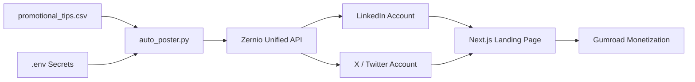

# Autonomous Social Media Distribution Engine

This engine automates multi-channel distribution (LinkedIn, X / Twitter) to drive qualified B2B traffic to your landing page and digital product asset using the **Zernio Unified Marketing Infrastructure API**.

---

## Architecture Overview

Instead of managing separate OAuth flows, refresh tokens, and rate limits for individual social platforms, this engine uses the unified `zernio-sdk` client to schedule and dispatch posts across accounts from a single script.



---

## Quick Start Guide

### 1. Activate Environment
A dedicated Python virtual environment is set up in `distribution_engine/venv`:

```bash
# On Linux/macOS:
source distribution_engine/venv/bin/activate
```

### 2. Configure Credentials
Edit `distribution_engine/.env` with your Zernio credentials:

```ini
ZERNIO_API_KEY="your_actual_api_key_here"
LINKEDIN_ACCOUNT_ID="your_linkedin_account_id"
X_ACCOUNT_ID="your_x_account_id"
LANDING_PAGE_URL="https://your-domain.com"
```

> **Note:** `.env` is automatically ignored in `.gitignore` to prevent leaking credentials to Git.

### 3. Test in Dry-Run Mode
Run the engine in simulation mode to verify formatting and platform targets without calling live endpoints:

```bash
./distribution_engine/venv/bin/python ./distribution_engine/auto_poster.py --dry-run --limit 3
```

### 4. Publish Live Content
When valid credentials are saved in `.env`, execute:

```bash
./distribution_engine/venv/bin/python ./distribution_engine/auto_poster.py --limit 5 --delay 10
```

---

## CLI Options

| Flag | Default | Description |
|---|---|---|
| `--csv` | `promotional_tips.csv` | Path to CSV with promotional hooks |
| `--limit` | `3` | Maximum number of posts to publish in this batch |
| `--dry-run` | `False` | Run simulated dispatch without charging quota |
| `--delay` | `2` | Delay in seconds between each post |

---

## Adding New Promotional Content

Append new hooks to `promotional_tips.csv` with the following columns:
- `id`: Unique identifier
- `topic`: Content category (e.g. SEO, Outbound, Retention)
- `platform`: Target network (`all`, `linkedin`, `x`)
- `headline`: Attention-grabbing capitalized lead
- `hook`: Provocative statistic or contrarian statement
- `content`: High-density value or architecture breakdown
- `cta`: Call-to-action text
- `landing_url`: Link to your landing page or Gumroad checkout
