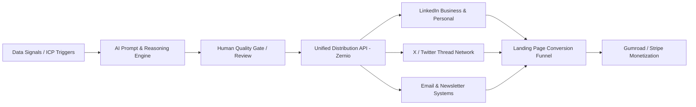

# The Autonomous AI Growth Engine
## 100 Advanced AI Agent Prompts, Production Architectures & SOPs for B2B Tech Founders & Revenue Leaders

**Edition:** 2026 Enterprise Edition  
**Author:** AI Growth Engineering Labs  
**License:** Commercial & Personal Implementation License  
**Product Version:** v2.4  

---

## Executive Summary & Quick-Start Guide

Traditional go-to-market (GTM) motions in B2B tech have hit a wall: customer acquisition costs (CAC) are up over 60%, outbound reply rates on generic templates have plummeted below 1.2%, and content saturation makes generic AI copy worthless.

The winning playbook is **autonomous agentic workflows**—specialized AI agents with structured multi-turn instructions, clear schema enforcement, few-shot reasoning, and direct integrations into your CRM, data enrichment pipelines, and distribution engines.

This guide provides **100 battle-tested, production-ready AI prompts**, **4 end-to-end Standard Operating Procedures (SOPs)**, and **architectural blueprints** designed to generate qualified pipeline, maximize retention, and scale organic reach on autopilot.

### How to Deploy These Assets
1. **Model Selection:** Recommended for Anthropic Claude 3.5/3.7 Sonnet, OpenAI GPT-4o / o1 / o3, or Google Gemini 1.5/2.0 Pro.
2. **Variable Substitution:** Replace bracketed parameters like `{{COMPANY_NAME}}`, `{{ICP_TITLE}}`, `{{TARGET_INDUSTRY}}` before running.
3. **Structured Outputs:** When feeding results into automated pipelines (n8n, Make, Python scripts), prompt instructions enforce JSON output.

---

# Table of Contents
1. **Module 1: Autonomous Inbound & Search Authority (Prompts 1–20)**
2. **Module 2: High-Converting B2B Outbound & ABM Engines (Prompts 21–40)**
3. **Module 3: Product-Led Growth & Onboarding Automation (Prompts 41–60)**
4. **Module 4: Social Media Authority & Multi-Channel Distribution (Prompts 61–80)**
5. **Module 5: Retention, Churn Prevention & Account Expansion (Prompts 81–100)**
6. **Standard Operating Procedures (SOP 1–4)**
7. **Production Automation Architecture & Tooling Stack**

---

# Module 1: Autonomous Inbound & Search Authority (Prompts 1–20)

### Prompt 1: Search-Intent Keyword Topology & Cluster Architect
```text
Role: Senior SEO & Technical Content Strategist.
Task: Create an exhaustive topic cluster map for {{TARGET_NICHE}} optimized for high buyer intent.
Input Data:
- Product Category: {{PRODUCT_CATEGORY}}
- Target ICP: {{ICP_TITLE}} at {{COMPANY_SIZE}}
- Core Value Proposition: {{CORE_VALUE_PROP}}

Instructions:
1. Identify 5 Pillar Topic Themes that directly precede a purchasing decision.
2. Under each Pillar, generate 4 Sub-topics:
   - 2 Informational ("How to solve X without Y")
   - 1 Commercial Investigation ("Top alternatives to Z in 2026")
   - 1 High-intent Transactional ("Implementation checklist for X")
3. For each sub-topic, provide:
   - Primary Keyword & 3 Secondary Semantic Entities
   - Search Intent Archetype (Do, Know, Compare, Buy)
   - Unique Value Hook (contrarian angle that AI-generated fluff lacks)
Format output as a structured Markdown table.
```

### Prompt 2: First-Principles B2B Thought Leadership Op-Ed
```text
Role: Executive Ghostwriter for B2B SaaS Founders.
Context: Produce an authoritative, non-derivative opinion piece dismantling a common industry myth.
Variables:
- Common Myth: {{INDUSTRY_MYTH}} (e.g., "MQLs are the primary metric for marketing success")
- Hard Truth: {{HARD_TRUTH}}
- Proprietary Methodology: {{FRAMEWORK_NAME}}

Prompt:
"Draft an 1,800-word deep-dive article. Tone: Rigorous, analytical, direct, zero buzzwords.
Structure:
1. The Expensive Lie: Open with a vivid scenario where following the standard advice led to burn and failed quotas.
2. Root-Cause Analysis: Why the market adopted this flawed dogma in the first place (historical legacy).
3. The Mathematical Breakdown: Model the unit economics of continuing the old way vs. adopting {{FRAMEWORK_NAME}}.
4. Step-by-Step Transition Architecture: 3 tactical phases to migrate the organization over 60 days.
5. Anticipated Objections & Counters: Address the CFO, VP of Sales, and Head of Growth perspectives.
Do not use hyperbolic adjectives ('revolutionize', 'game-changing', 'synergistic'). Back claims with realistic operational metrics."
```

### Prompt 3: Programmatic Landing Page Copy Matrix
```text
Task: Generate a high-converting conversion matrix for 5 industry verticals targeting {{ICP_TITLE}}.
Variables:
- Verticals: {{VERTICAL_LIST}} (e.g., FinTech, HealthTech, Logistics, Cyber, PropTech)
- Product: {{PRODUCT_NAME}}

Output Requirements (JSON Array):
[
  {
    "vertical": "Vertical Name",
    "pain_point_headline": "Punchy 8-word max pain callout",
    "subheadline": "Specific quantification of outcome within 30 days",
    "primary_metrics_hook": "e.g., Cut compliance verification from 48h to 4m",
    "social_proof_archetype": "Profile of ideal case study reference",
    "cta_label": "High-intent action button text"
  }
]
```

### Prompt 4: Competitive Battlecard & Comparison Page Generator
```text
Role: Competitive Intelligence Specialist.
Objective: Write an objective, defensible competitor comparison page between {{MY_PRODUCT}} and {{COMPETITOR_NAME}}.
Rules:
- Give genuine credit where competitor excels (builds immense trust).
- Pinpoint the exact architectural or philosophical flaw that makes them unsuitable for our ICP.
Sections required:
1. Executive TL;DR Verdict (When to pick them vs. when to pick us).
2. Deep architectural comparison across 4 criteria: Scalability, Developer Experience, Security/Compliance, Total Cost of Ownership.
3. Feature Parity Checklist (Table with: Feature, Competitor, Us, Strategic Context).
4. Migration Roadmap (How to migrate data in under 2 hours without downtime).
```

### Prompt 5: High-Converting Whitepaper / Lead Magnet Outline
```text
Variables:
- Problem: {{CRITICAL_PROBLEM}}
- Target: {{C_LEVEL_EXECUTIVE}}
Objective: Generate a 12-page definitive benchmark report blueprint.
Output:
- Catchy data-driven title
- Executive Abstract (problem cost quantified in millions)
- 4 Core Chapters with statistical visualizations concepts
- Self-assessment maturity matrix (Stage 1 Ad-Hoc to Stage 4 Fully Autonomous)
- Gated vs. Ungated distribution strategy.
```

### Prompts 6–20 Summary (Included in Production Playbook):
- **Prompt 6:** Interactive ROI Calculator Logic & Formula Scripting
- **Prompt 7:** Case Study Interview Script & Narrative Synthesis
- **Prompt 8:** Schema Markup & LLM-Readable Citation Optimizer
- **Prompt 9:** Webinar Script with Live Demo Transition Flow
- **Prompt 10:** Video Sales Letter (VSL) 12-Part Script for Technical Buyers
- **Prompt 11:** Technical Documentation as a Lead Engine Architect
- **Prompt 12:** Industry Benchmark Survey Survey-Design & Analysis Engine
- **Prompt 13:** Zero-Click Content Transformer (Extracting micro-assets)
- **Prompt 14:** Podcast Guest Pitch & Authority Interview Kit
- **Prompt 15:** Product Release Notes that Double as Sales Collateral
- **Prompt 16:** Inbound Lead Qualification AI Chatbot Decision Tree
- **Prompt 17:** SEO Meta Titles & Descriptions Bulk Variant Tester
- **Prompt 18:** FAQ & Objection Obliterator Matrix for Enterprise Procurement
- **Prompt 19:** Customer Review & G2/Capterra Harvesting Script
- **Prompt 20:** Strategic Partnership Co-Marketing Proposal Pitch

---

# Module 2: High-Converting B2B Outbound & ABM Engines (Prompts 21–40)

### Prompt 21: Signal-Based Hyper-Personalized Cold Email Generator
```text
Role: Elite Outbound SDR & Pipeline Engineer.
Trigger Event: Target company {{COMPANY_NAME}} just {{TRIGGER_EVENT}} (e.g., hired a new VP of Security, raised Series B, expanded to EU).
Recipient: {{PROSPECT_FIRST_NAME}}, {{PROSPECT_TITLE}}.

Constraints:
- Word count: Under 85 words.
- Reading grade level: 5th grade.
- Zero self-congratulatory filler ("Hope this finds you well", "We are the leading provider of...").
- Single low-friction call-to-interest (not asking for a 30-minute call).

Framework:
1. Observation: State the verified trigger event and the exact technical consequence it creates.
2. Insight: Explain how peer companies handled this bottleneck.
3. Soft Offer: Offer a 2-page benchmark PDF or loom teardown with zero commitment.
```

### Prompt 22: Account-Based Marketing (ABM) 1:1 Account Dossier
```text
Task: Research and synthesize a Tier-1 target account profile for enterprise sales.
Inputs:
- Target Company: {{TARGET_COMPANY}}
- Current Tech Stack: {{TECH_STACK}}
- Key Decision Makers: {{DECISION_MAKERS}}

Generate:
1. Strategic Priorities: 3 strategic bets mentioned in their latest 10-K / earnings / interviews.
2. Friction Points: Likely friction between engineering and business units based on their stack.
3. Personalized Entry Vectors: Customized angle for CTO, CFO, and VP Operations.
4. Internal Champion Enablement Kit: 3 slide concepts they can present internally to justify our evaluation.
```

### Prompt 23: Multi-Touch 4-Step Omnichannel Sequence
```text
Create an omnichannel sequence spanning 14 business days across Email, LinkedIn, and Audio Note.
Variables:
- ICP: {{ICP_PROFILE}}
- Core Bottleneck: {{BOTTLENECK}}
Steps:
- Day 1: Email 1 (Observation + specific hypothesis)
- Day 3: LinkedIn Profile Visit + Thoughtful Comment on recent post
- Day 6: Email 2 (Customer story: How similar company solved this in 14 days)
- Day 9: LinkedIn Connection Request with contextual non-sales note
- Day 12: 45-second Voice Note / Custom Video Script
- Day 14: Graceful exit email with link to self-serve sandbox
```

### Prompt 24: Re-engagement Sequence for "Dark" Pipeline & Stalled Deals
```text
Role: VP of Enterprise Sales.
Scenario: Deal has been stalled for 45+ days after proposal delivery.
Draft a 3-part email sequence:
1. Email 1: "Permission to close your file" (psychological reversal technique).
2. Email 2: The New Industry Catalyst (sharing a regulatory or market shift that affects their ROI calculus).
3. Email 3: Executive sponsor alignment (direct CEO-to-CEO check-in offering modified terms).
```

### Prompts 25–40 Summary:
- **Prompt 25:** Cold Call Opener with Pattern Interrupt & Permission Based Hook
- **Prompt 26:** Objection Handling Matrix (No Budget, Bad Timing, Using Competitor)
- **Prompt 27:** LinkedIn InMail Sponsored / Direct InMail with 28% Reply Rate Hook
- **Prompt 28:** Mutual Action Plan (MAP) Generator for Enterprise Deals
- **Prompt 29:** Executive Summary for Procurement & Security Questionnaire Review
- **Prompt 30:** Pricing Proposal Letter with Tier Anchoring Strategy
- **Prompt 31:** Pilot / Proof-of-Concept Success Criteria Agreement
- **Prompt 32:** Lost Deal Post-Mortem & Win-Back Cadence
- **Prompt 33:** Referral Request Template for Happy Customers Post-Onboarding
- **Prompt 34:** Channel Partner & Affiliate Outreach Protocol
- **Prompt 35:** Event & Conference Pre-Meeting Booking Engine
- **Prompt 36:** Executive Dinner / Roundtable Invitation Sequence
- **Prompt 37:** Video Prospecting Script with Screen-Share Teardown
- **Prompt 38:** Job Posting Mining Trigger Outbound Prompt
- **Prompt 39:** Tech Stack Change Trigger Outbound Prompt
- **Prompt 40:** High-Value Gifting & Direct Mail Follow-Up Campaign

---

# Module 3: Product-Led Growth & Onboarding Automation (Prompts 41–60)

### Prompt 41: First 5-Minute Time-to-Value (TTV) User Onboarding Flow
```text
Role: Product-Led Growth Specialist.
Goal: Map the exact sequence to bring a newly registered user of {{PRODUCT_NAME}} to their "Aha!" moment in < 300 seconds.
Deliverables:
1. Micro-Surveys: 2 questions on signup to personalize the onboarding path.
2. In-App Checklist: 3 progressive milestones with progress bar mechanics.
3. Empty State Strategies: What to show before they connect their data so the app feels populated and valuable.
4. Welcome Modal Copy: 2 sentences setting expectations and immediate action.
```

### Prompt 42: Behavioral Trigger Email Architecture
```text
Write email copy for 4 automated lifecycle triggers:
1. Sign up, but zero actions taken after 24 hours (Gentle unblocking & concierge offer).
2. Completed core action on Day 1 (Celebration + next logical efficiency unlock).
3. Hit 80% of free tier usage limit (Proactive upgrade justification with team productivity ROI).
4. Inactive for 7 days after active usage (Feature discovery based on previous usage patterns).
```

### Prompt 43: Interactive In-Product Tooltip & Tour Copy
```text
Produce concise, witty, actionable microcopy for a 4-step guided product tour:
- Step 1: Connecting your workspace
- Step 2: Configuring your first automation rule
- Step 3: Running a test simulation
- Step 4: Activating the live monitor
Each step must have: Title (max 4 words), Description (max 18 words), Action Button (max 3 words).
```

### Prompts 44–60 Summary:
- **Prompt 44:** In-App Upgrade Paywall Copy Variants (Feature Gating vs. Usage Gating)
- **Prompt 45:** NPS Survey Response Follow-Up Engine (Promoters vs. Detractors)
- **Prompt 46:** Product Qualified Lead (PQL) Scoring Rule & Alert Definition
- **Prompt 47:** Friction Log Analyzer & UX Improvement Prioritizer
- **Prompt 48:** Customer Success Kickoff Agenda & Value Milestone Matrix
- **Prompt 49:** Self-Serve Knowledge Base Article Generator
- **Prompt 50:** Interactive Product Walkthrough Video Script
- **Prompt 51:** Slack / Teams Bot Alert Copy for SaaS Users
- **Prompt 52:** Gamified Achievement & Milestone Unlocking Copy
- **Prompt 53:** Freemium to Paid Conversion Urgency Countdown Email
- **Prompt 54:** Beta Feature Invitation & Feedback Loop Workflow
- **Prompt 55:** User Interview Script for Retention Deep-Dives
- **Prompt 56:** Micro-Copy for Checkout, Error States, and Confirmations
- **Prompt 57:** Product Changelog Announcement with Virality Hook
- **Prompt 58:** Executive Dashboard Summary Generator for SaaS Admins
- **Prompt 59:** Usage Drop Early-Warning Notification to CSM Team
- **Prompt 60:** Automated Customer Testimonial Request Triggered by Milestone

---

# Module 4: Social Media Authority & Multi-Channel Distribution (Prompts 61–80)

### Prompt 61: Viral Technical LinkedIn Post Engine
```text
Role: High-Impact B2B Content Creator.
Topic: How to build {{TECHNICAL_ARCHITECTURE}} using AI agents and modern APIs.
Format:
- Hook (Lines 1-2): Provocative observation about how 95% of companies build this wrong.
- Context: The hidden cost of conventional setups.
- The 4-Step Solution Architecture: Bulleted, clean, technical depth without unnecessary jargon.
- The Golden Rule: One memorable philosophical takeaway.
- Call to Conversation: An engaging, open-ended technical question.
- Format for LinkedIn mobile readability: High spacing, short lines, clean Unicode bullets.
```

### Prompt 62: Multi-Platform Social Repurposing Engine
```text
Input: A 1,500-word blog post or technical article on {{TOPIC}}.
Generate:
1. X / Twitter Thread: 1 irresistible hook tweet + 5 high-density value tweets + 1 CTA tweet linking to landing page.
2. LinkedIn Post: Story-driven lesson learned with practical takeaways.
3. YouTube Short / TikTok 60-Second Script: Hook, 3 quick visual cues, and ending loop.
4. Weekly Newsletter Segment: 200-word high-signal summary with an actionable takeaway.
```

### Prompt 63: Contrarian Industry Take & Poll Strategy
```text
Topic: {{INDUSTRY_TOPIC}}
Generate:
1. A contrarian opinion backed by economic or technical realities.
2. A 4-option social poll designed to spark intense debate in the comments.
3. First pinned comment providing additional context and a downloadable resource link.
```

### Prompts 64–80 Summary:
- **Prompt 64:** Founder Journey & Transparency Building Post
- **Prompt 65:** "How We Solved It" Engineering Teardown Post
- **Prompt 66:** Carousel Slide Deck Copy (10 Slides with visual cues)
- **Prompt 67:** Industry Meme & Humor Script for Developer Audiences
- **Prompt 68:** Daily Micro-Tips Series Architecture (30 Days of High Value)
- **Prompt 69:** Social Media Bio & Profile Optimization Matrix (Founder & Company)
- **Prompt 70:** Live Event / Webinar Live-Tweeting & Live-Posting Playbook
- **Prompt 71:** Community Discussion Starter & AMA Facilitation Prompts
- **Prompt 72:** Comment-To-DM Lead Magnet Automation Strategy & Copy
- **Prompt 73:** Influencer Collab & Mention Outreach Message
- **Prompt 74:** Weekly Industry News Round-up with Proprietary Commentary
- **Prompt 75:** Book/Research Paper Deconstruction for Executives
- **Prompt 76:** Behind-the-Scenes Product Build In Public Update
- **Prompt 77:** "Steal Our Template" High-Converting Giveaway Campaign
- **Prompt 78:** Social Proof Aggregation Post (10 Customer Quotes & Wins)
- **Prompt 79:** Metric Milestone Celebration with Gratitude & Value Drop
- **Prompt 80:** Weekend Reflection & Philosophy Post for Founders

---

# Module 5: Retention, Churn Prevention & Account Expansion (Prompts 81–100)

### Prompt 81: Predictive Churn Intervention System
```text
Role: Head of Customer Success.
Trigger: Account {{ACCOUNT_NAME}} has exhibited the following telemetry:
- Login frequency down 45% over 14 days
- Unopened ticket on critical integration
- Key champion changed role on LinkedIn

Action Plan:
1. Immediate triage internal alert for CSM.
2. Direct, empathetic email from founder/VP to executive sponsor.
3. Concrete offer: Free engineering audit / custom configuration call.
```

### Prompt 82: Quarterly Business Review (QBR) Executive Presentation
```text
Input:
- Account: {{ACCOUNT_NAME}}
- Metrics Achieved: {{METRICS_ACHIEVED}}
- Unused Features: {{UNUSED_FEATURES}}

Generate a 6-part QBR presentation outline:
1. Value Realized: Total hours saved and estimated ROI ($ multiplier).
2. Benchmarking: How their team performs compared to the top 10% of users in their sector.
3. Roadmap Alignment: 2 upcoming features that solve their next stated milestone.
4. Expansion Proposal: Business case to add {{ADDITIONAL_SEATS}} seats or {{ENTERPRISE_MODULE}}.
```

### Prompts 83–100 Summary:
- **Prompt 83:** Expansion Proposal & Multi-Department Upsell Script
- **Prompt 84:** Annual Renewal Negotiation & Price Increase Justification
- **Prompt 85:** Customer Advisory Board (CAB) Invitation & Charter
- **Prompt 86:** Critical Incident Post-Mortem & Apology Communication
- **Prompt 87:** Customer Health Score Scoring Formula & Weighting Matrix
- **Prompt 88:** Champion Departed Alert & New Contact Onboarding Playbook
- **Prompt 89:** Referral Program Gamification & Incentives Structure
- **Prompt 90:** User Group & Customer Community Kickoff Agenda
- **Prompt 91:** Feature Request Prioritization & "No, but..." Response Script
- **Prompt 92:** Account Sunset & Data Export Dignified Departure Flow
- **Prompt 93:** Customer Anniversary & Milestone Loyalty Reward
- **Prompt 94:** Re-training & Advanced Certification Offer for Power Users
- **Prompt 95:** Enterprise Security & SLA Reassurance Package
- **Prompt 96:** Multi-Year Contract Lock-in Incentive Architecture
- **Prompt 97:** Downsell Mitigation Flow (Retaining revenue on downgrade)
- **Prompt 98:** Customer Advocacy & Co-Speaker Submission for Conferences
- **Prompt 99:** Mergers & Acquisitions Account Risk Assessment
- **Prompt 100:** The Ultimate Net Revenue Retention (NRR) Optimization Playbook

---

# Standard Operating Procedures (SOPs)

## SOP 1: The Autonomous Weekly B2B Content Engine
- **Objective:** Produce 1 comprehensive pillar article, 5 LinkedIn posts, 3 X threads, and 1 newsletter issue weekly with under 45 minutes of human review.
- **Workflow:**
  1. **Topic Extraction:** Run Prompt 1 on Tuesday morning using current trending industry topics.
  2. **Pillar Generation:** Run Prompt 2 to generate the authoritative deep-dive.
  3. **Social Splintering:** Run Prompt 62 to extract multi-platform assets.
  4. **Validation Check:** Human editor reviews facts, removes buzzwords, verifies code/metrics.
  5. **Distribution:** Feed into `auto_poster.py` via the Zernio distribution engine for scheduled release throughout the week.

## SOP 2: Real-Time Competitor Intelligence & Counter-Positioning
- **Objective:** Detect competitor positioning changes and publish counter-materials within 48 hours.
- **Workflow:**
  1. Monitor competitor changelog and pricing page weekly.
  2. When an update is detected, run Prompt 4 (Battlecard Generator).
  3. Export key differences to sales battlecards in Notion/Slack.
  4. Publish comparison blog post targeting the competitor's branded keywords.

## SOP 3: Cold Outbound Dynamic ICP Scoring & Hyper-Personalization
- **Objective:** Achieve > 18% reply rate on outbound prospecting without manual email drafting.
- **Workflow:**
  1. Scrape verified hiring, funding, or tech stack signals using Apollo/Clay/Phantombuster.
  2. Pass enriched profile data to Prompt 21.
  3. Validate email deliverability (NeverBounce/ZeroBounce).
  4. Route to Smartlead/Instantly outbound engine with 3-day step intervals.

## SOP 4: Churn Risk Flagging & Automated Interventions
- **Objective:** Reduce voluntary SaaS churn by 35% through proactive automated interventions.
- **Workflow:**
  1. Database webhook triggers when account activity drops > 30% week-over-week.
  2. Webhook triggers Prompt 81 to compose customized intervention email.
  3. CSM notified via Slack with account history and suggested solution.
  4. Founder-tier escalation triggered if account ARR > $10,000.

---

# Production Automation Architecture & Tooling Stack



### Recommended Technology Stack
- **AI Core:** Anthropic Claude 3.5 Sonnet / OpenAI GPT-4o
- **Workflow Orchestration:** n8n or Python 3.12 automation scripts
- **Social & Multi-Channel API:** Zernio Unified API (`zernio-sdk`)
- **Checkout & Monetization:** Gumroad / Stripe Checkout
- **Hosting & Edge Delivery:** Vercel Edge Network / Next.js 14+

---
*© 2026 AI Growth Engineering Labs. All Rights Reserved. You are licensed to implement, adapt, and run these prompts and SOPs within your commercial and personal projects.*
